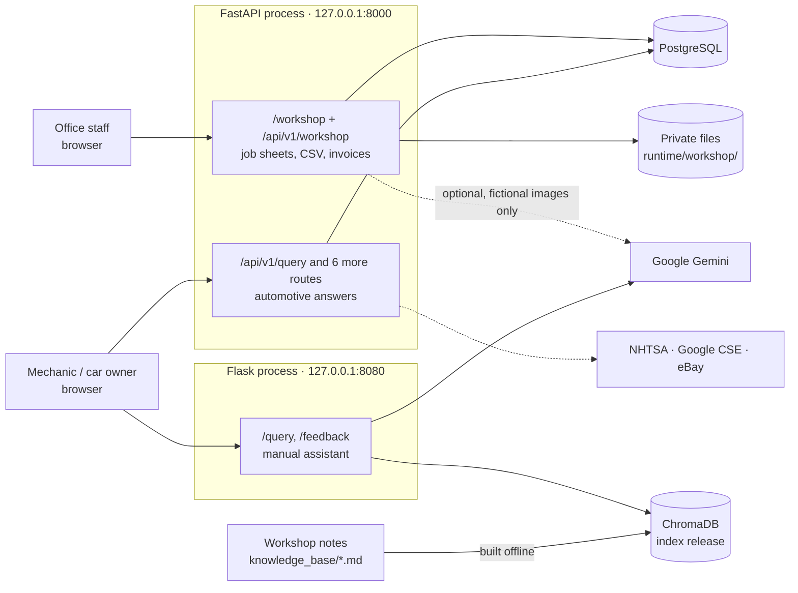
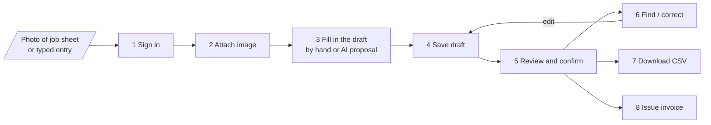
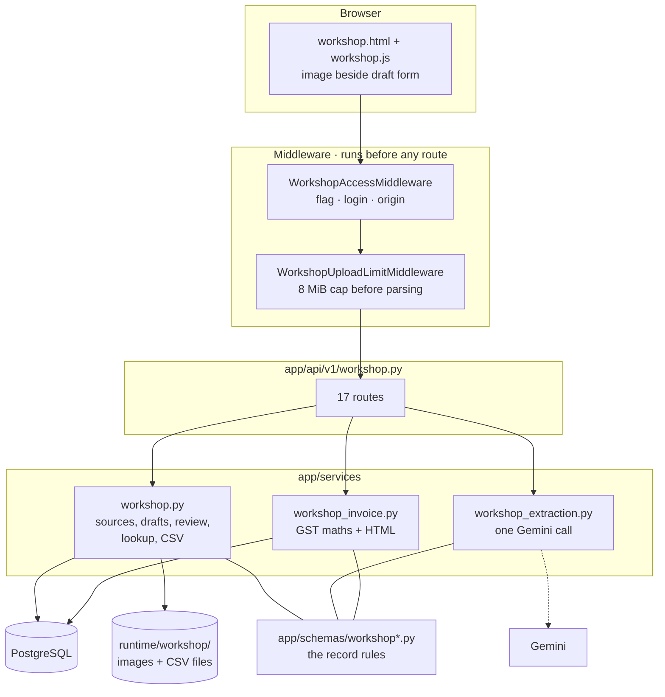
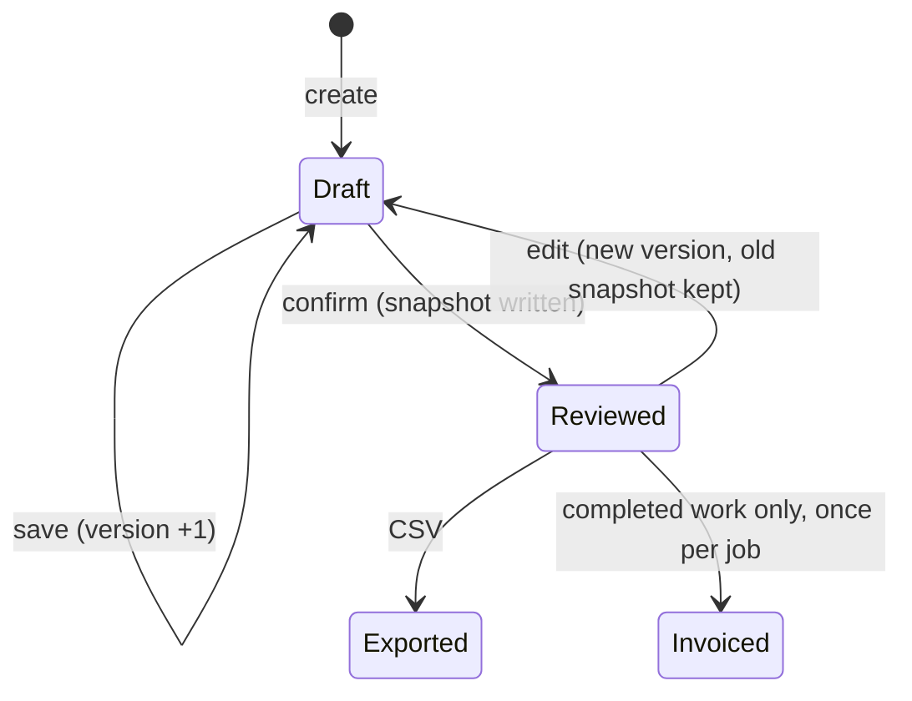
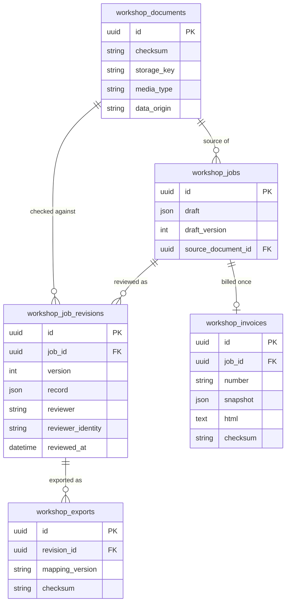
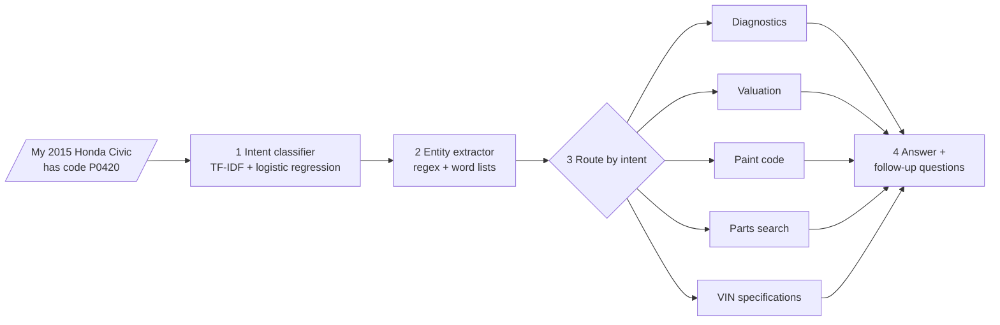
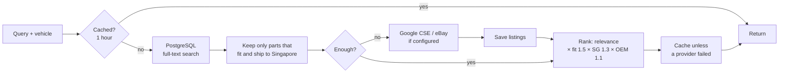
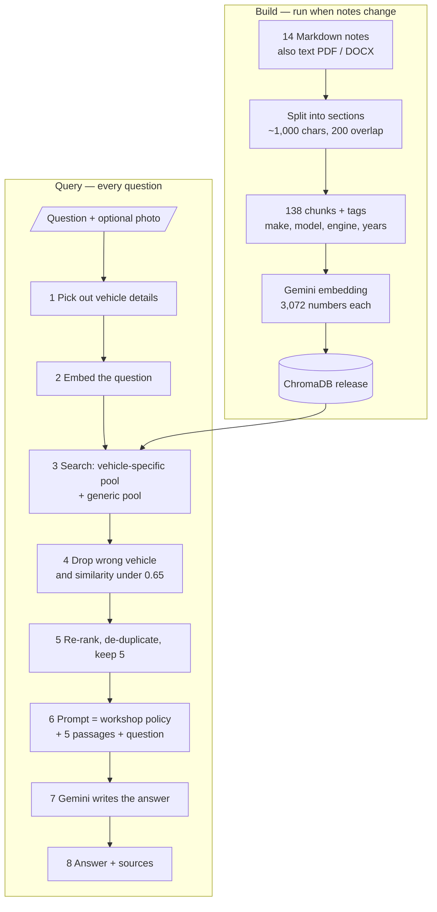
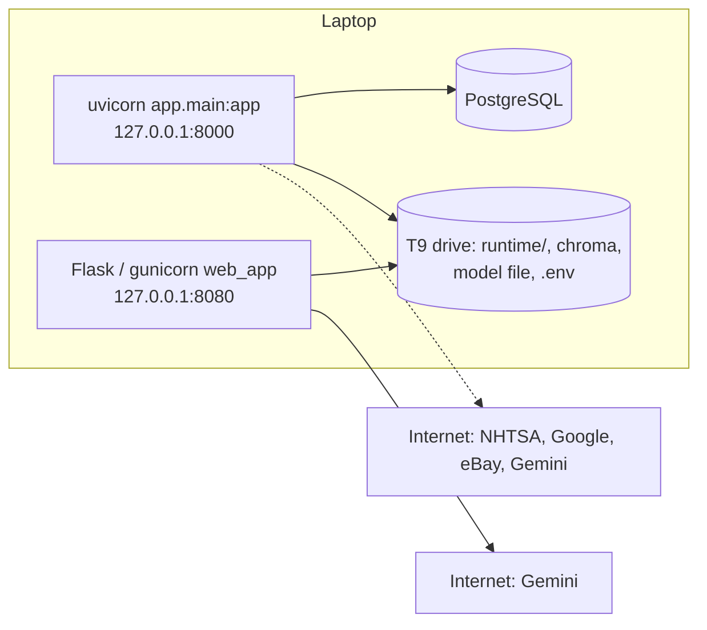

# System Design — As Built

**Date:** 2026-10-12
**Scope:** what exists and runs in this repo today. `ARCHITECTURE.md` is the old
*planned* design (Neo4j, Redis, deep-learning models) and was never built; where the
two differ, this document is correct.

Slides walking through the pipeline step by step: [`slides/slides.md`](slides/slides.md)
(`cd slides && npm install && npm run dev`).

The repo holds **three parts in two processes**:

| | 1. Workshop job sheets | 2. Automotive API | 3. Manual assistant |
|---|---|---|---|
| What it does | Turns a paper job sheet into a reviewed record, CSV and invoice | Answers a car question from lookup tables and a parts catalogue | Answers a repair question from workshop notes, written by an AI |
| Code | `app/` (`workshop*` files) | `app/` (everything else) | `car mechanic assistant/` |
| Process | FastAPI, port 8000 | Same FastAPI process | Flask, port 8080 |
| Storage | PostgreSQL (5 tables) + private files on disk | PostgreSQL (11 tables) | ChromaDB files + SQLite feedback |
| AI | Optional Gemini draft, off by default | Small local classifier (scikit-learn) | Gemini embeddings + Gemini answers |
| Works without internet | Yes (manual entry) | Mostly (not VIN lookup or web parts search) | No |
| Login | Yes — one configured account | None | None |
| Status | Verified locally with fictional records; no company pilot yet | Seven routes verified locally | Verified locally on 14 notes |

Part 1 is the current project. Parts 2 and 3 are older and separate: they share the
repo (and part 2 shares the server and database), but no workshop record ever flows
into them.

---

## 1. The big picture

Solid lines are used on every request. Dotted lines are optional or feature-specific.

---

# Part 1 — Workshop job sheets

## 1.1 The pipeline, input to output

**Input:** one JPEG/PNG photo of a job sheet, or values typed in directly.
**Outputs:** a reviewed record that can be found again, a CSV file, and (for
completed work) an invoice with GST.

| # | Step | Route | What happens | What stops it |
|---|---|---|---|---|
| 1 | Sign in | every `/workshop` route | Feature flag on, one configured account (scrypt-hashed password), exact origin match | Off → 404. Bad config → 503. Wrong login → 401. Other site → 403 |
| 2 | Attach image | `POST /documents` | Image is decoded and checked, stored under a random ID, SHA-256 recorded; same bytes are reused, not duplicated | Not JPEG/PNG, over 8 MiB, over 6,000 px a side or 20 megapixels, corrupt |
| 3a | Type the draft | (browser only) | Staff copy what is written. Each value has a literal text and a clarified value, plus a state: `missing`, `unclear`, `proposed`, `confirmed` | — |
| 3b | AI proposal (optional) | `POST /documents/{id}/extract` | One Gemini call returns JSON matching the draft schema. Every value comes back as `proposed`, never `confirmed`. Nothing is saved | Image marked as a real company record → 403, always. AI off or no key/model → 503. Bad JSON → 502. Over 60 s → 504 |
| 4 | Save draft | `POST /jobs`, `PATCH /jobs/{id}` | Whole draft stored as JSON with a version number that goes up on every save | Saving over someone else's newer save → 409 |
| 5 | Review and confirm | `POST /jobs/{id}/confirm` | Checks the reviewed-record rules, re-verifies the image hash, writes one **immutable** snapshot stamped with the signed-in account and server time | Stage unknown, no job reference, no confirmed item, any value still `proposed`/`unclear`, no source or provenance |
| 6 | Find / correct | `GET /jobs`, `GET /jobs/{id}/revisions` | Search returns the latest reviewed snapshot per job. Editing makes a new draft version; old snapshots never change | — |
| 7 | CSV | `POST /revisions/{id}/exports` → `GET /exports/{id}/download` | 32-column file built from the snapshot, saved once, same bytes every time | Draft (not reviewed) IDs cannot export |
| 8 | Invoice | `POST /revisions/{id}/invoice-preview` → `POST /revisions/{id}/invoice` | GST worked out once on the subtotal; invoice stored as immutable HTML with a checksum; printed from the browser | Not `completed_work`, not SGD, an unpriced item, stale revision, job already invoiced, real record while real issuance is off |

All routes are under `/api/v1/workshop`. The page itself is `/workshop`.

## 1.2 Components

One rule set (`app/schemas/workshop.py`) is shared by manual entry, the AI proposal
and review. The AI cannot skip a check that a person would have to pass.

## 1.3 Record lifecycle

Two separate ideas, kept apart on purpose:

- **Review state** — has a person checked this? (`draft` → `reviewed`)
- **Record stage** — what is it? (`quote`, `approved_scope`, `completed_work`).
  Confirming a quote leaves it a quote.

## 1.4 Data model

- The draft is one JSON column, not a table per field. The real company columns are
  not known yet, so nothing is normalised early.
- Reviewed snapshots and invoices are protected by PostgreSQL triggers that reject
  UPDATE and DELETE.
- Image and CSV files live outside `app/static`, named by random ID, readable only by
  the server user. The original filename is never used as a path.
- `data_origin` (`synthetic_demo` or `private_source`) is set when a record is created
  and can never change. It decides whether AI and real invoicing are allowed.

## 1.5 Invoice maths

GST is 9%, in SGD, calculated **once on the subtotal** (never per line), rounded half
up to the cent.

| Pricing | GST | Example: one line at 109.00 |
|---|---|---|
| Inclusive (default) | subtotal × 9 / 109 | net 100.00 + GST 9.00 = 109.00 |
| Exclusive | subtotal × 9% | net 109.00 + GST 9.81 = 118.81 |
| Supplier not GST-registered | none | 109.00 |

Amounts are `Decimal` end to end and travel as two-decimal strings in JSON. An unknown
amount is empty, never zero.

## 1.6 Switches

Everything is off until turned on in `.env`:

| Setting | Default | Effect |
|---|---|---|
| `WORKSHOP_ENABLED` | off | Whole workshop area returns 404 |
| `WORKSHOP_AUTH_USERNAME`, `WORKSHOP_AUTH_PASSWORD_HASH`, `WORKSHOP_ORIGIN` | empty | Required once enabled; missing → 503 |
| `WORKSHOP_AI_ENABLED`, `WORKSHOP_AI_MODEL` | off, none | AI proposal button returns 503 |
| `WORKSHOP_REAL_INVOICES_ENABLED`, `WORKSHOP_BILLING_SUPPLIER` | off, none | Only fictional `DEMO-INV-…` invoices can be issued |

---

# Part 2 — Automotive API

## 2.1 Life of a question

**Input:** a typed question. **Output:** a structured answer with follow-up questions.

1. **Intent.** A small model trained on template-generated questions sorts the text
   into six buckets. It loads from disk in milliseconds; its training accuracy says
   nothing about real workshop phrasing.
2. **Details.** No AI. Regex finds VINs, fault codes, years and mileage (including
   `75k km`); word lists find makes, models, parts, symptoms and colours.
3. **Service.** Plain Python that reads a table and applies rules.

| Service | Logic | Source of truth |
|---|---|---|
| Diagnostics | Base probability per cause, adjusted by mileage and matching symptoms | Small Python dictionary |
| Valuation | New price → yearly depreciation → adjustments → three ranges. No comparable listings | Python dictionary |
| Paint code | Keyword-match the colour; return sticker locations | Python dictionary |
| Specifications | Check database; otherwise call NHTSA and save the result | NHTSA + PostgreSQL |
| Parts search | See below | PostgreSQL + optional web providers |
| Compatibility | Make/model/engine/year match against the catalogue | PostgreSQL |

## 2.2 Parts search

Each provider fails on its own without taking the other down. Unknown prices stay
null. A catalogue fit is not proof the part physically fits.

## 2.3 Data

Eleven tables: `vehicles`, `specifications`, `parts_catalog`, `part_prices`,
`part_compatibility_enhanced`, `search_cache`, `api_rate_limits`, and the older
`parts`, `part_compatibility`, `paint_codes`, `fault_codes`. Schema changes go through
Alembic only; the app never creates tables at startup.

---

# Part 3 — Manual assistant (RAG)

**Input:** a typed question, optionally a photo. **Output:** a written answer with the
notes it came from.

Re-rank score = similarity (0–100) + folder priority (3–10, "known issues" highest)
+ 20 per fault code that appears in both question and passage + 15 each for matching
make, model and engine.

- The workshop policy is always in the prompt but is never counted as a search hit.
- A photo is seen by Gemini but is **not** used for the search.
- Scanned (image-only) PDFs are rejected; there is no OCR.
- Index builds go to a new release folder; an index built with a different embedding
  model is refused, not silently reused.
- Feedback (thumbs and comments per answer) is kept in a private SQLite file.

---

# How it runs

- Both processes listen on the laptop only. Nothing is deployed publicly.
- `docker compose up --build` starts PostgreSQL, runs migrations once, then the API.
  It has not been run on this machine (no Docker installed).
- Tests: 326 passing, including 18 workshop cases against real PostgreSQL and a
  backup/restore drill. Browser flows were checked in Chrome.

# Design decisions and trade-offs

| Decision | Why | What it costs |
|---|---|---|
| Workshop lives inside the existing FastAPI app | No third server, reuses database, migrations and tests | Workshop and automotive routes share one process |
| Person confirms, AI only proposes | A wrong figure on an invoice is worse than slow entry | Every record needs a human pass |
| Immutable snapshots, new version per correction | Old CSVs and invoices stay explainable | History grows; nothing can be quietly fixed |
| Draft as one JSON column | Company's real columns are still unknown | Search scans JSON; not indexed for a large archive |
| AI blocked for real records in code, not config | Company has not agreed to send records to Google | Needs a code change once permission is given |
| One invoice per job, no edits | Simple and safe | No credit notes or re-issue yet |
| Single configured account, HTTP Basic | Enough for a one-laptop demo | No roles, no logout, no per-user records |
| Lookup tables for automotive answers | Predictable, free, offline | Knows only what was typed in by hand |
| RAG rather than asking Gemini directly | Answers cite the workshop's own notes | Only as good as 14 notes; needs internet |

# Limits today

1. **No real data yet.** Every workshop record, CSV and invoice so far is fictional.
   Handwriting accuracy is unmeasured.
2. **Company answers outstanding:** what the shorthand means, permission to send
   images to an AI provider, exact supplier name/address/GST number, who operates it.
3. **Single machine, single account.** No HTTPS, backups schedule or user management.
4. **CSV is a demo layout**, not matched to any accounting software.
5. **Invoicing stops at the invoice.** No payments, credit notes, InvoiceNow or GST
   returns.
6. **Parts 2 and 3 have thin knowledge** — small lookup tables and 14 notes.
