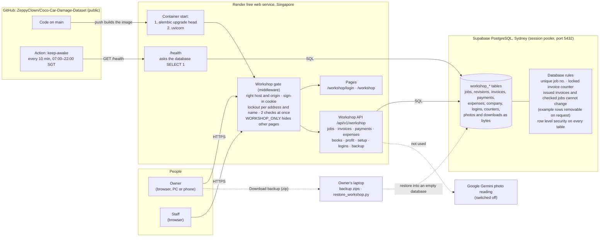
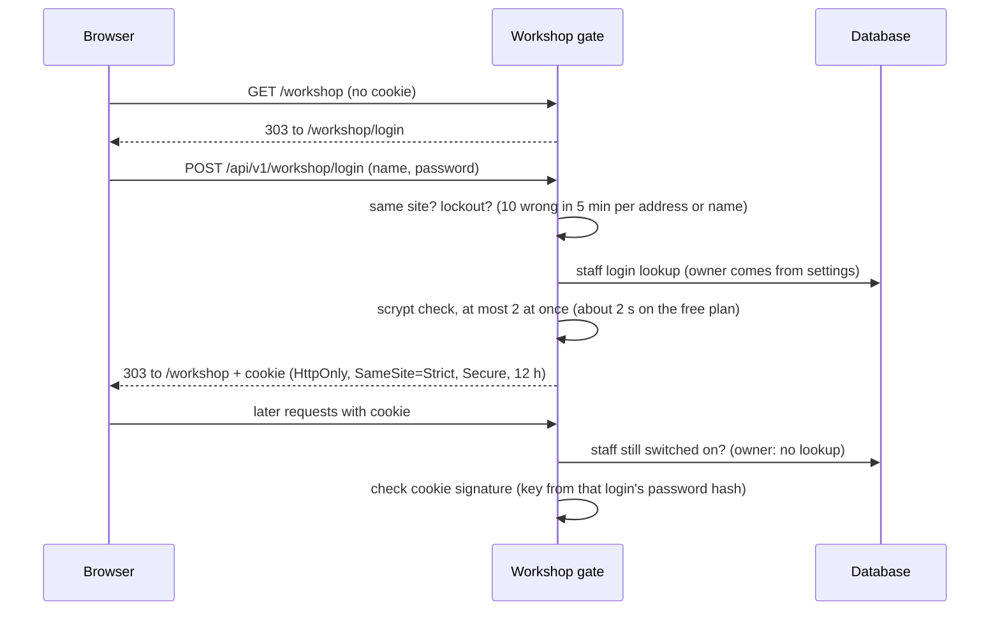

# Workshop job-sheet app: system design

Written 14 October 2026 (F21). It describes what is built and running, not plans. Hosting steps: [WORKSHOP_HOSTING.md](WORKSHOP_HOSTING.md). Feature ledger: [WORKSHOP_MASTER_PLAN.md](WORKSHOP_MASTER_PLAN.md).

## The parts

| Part | Where | What it holds or does |
|---|---|---|
| Browser | Owner and staff devices | The job sheet page (`workshop.html`, `workshop.js`). Keeps typed work on screen until saved. Holds only the sign-in cookie. |
| Render web service | Render, Singapore, free plan (512 MB, sleeps after 15 idle minutes) | One Docker container. Updates the database, then serves. Has no disk that survives a restart, so it keeps nothing of its own. |
| Supabase PostgreSQL | Supabase, Sydney, free plan (500 MB) | Every record and file: jobs, checked versions, invoices, payments, expenses, workshop details, blank form picture, job photos, download files, staff logins. |
| GitHub | Public repository | Code. Render builds from `main`. The keep-awake Action stops the app sleeping during shop hours. |
| Laptop | Owner | Backup zips. `scripts/restore_workshop.py` puts one into an empty database, which is also how the database moves to another region. |

## Who can do what

- **Owner login** comes from Render's settings (`WORKSHOP_AUTH_USERNAME`, `WORKSHOP_AUTH_PASSWORD_HASH`); only a salted scrypt hash is stored.
- **Further logins** (staff or owner) are added by an owner in Workshop details and kept in `workshop_users`, also as scrypt hashes. A login is switched off, never deleted.
- **Staff** do the daily work. **Owners** also change workshop details, the blank form, logins, example jobs and download backups.
- Each job check, invoice, payment and expense records the signed-in name, never a typed one.

## Signing in

The password is checked once per sign-in. The cookie is signed with a key made from the login's password hash, so changing a password or switching a login off ends its sessions. Sign out removes the cookie.

## Issuing an invoice

1. A finished job is checked ("confirmed"). That makes an unchangeable version in `workshop_job_revisions`.
2. *Issue invoice* reads the workshop details from `workshop_company` and takes the year's next number from `workshop_invoice_counters`. The UPDATE locks that row until the invoice is saved, so two people issuing at once get consecutive numbers (`INV-2026-0001`, `-0002`).
3. The invoice is stored with its printed HTML and a checksum. A database rule refuses any later change or deletion.

## Rules kept by the database, not just the app

| Rule | How |
|---|---|
| No two jobs share a job no. | Unique index on `workshop_jobs.job_number` (letters and digits, upper case) |
| No clashing invoice numbers | Locked counter row per year |
| Issued invoices and checked jobs never change | PostgreSQL triggers. Only rows marked as made-up examples can be deleted, and only while *Remove example jobs* runs. |
| Expenses point at real jobs | Foreign key `workshop_expenses.job_number` |
| Supabase's public data API cannot read the tables | Row level security on every table, with no policies; the app's own login owns the tables |

## Known limits

- **Free-plan sizes.** 512 MB of memory on Render; 500 MB of database on Supabase, which photos share with the books.
- **Backups.** Someone has to click *Download backup*; nothing makes one automatically.
- **Region gap.** The database is in Sydney and the app in Singapore until it is moved (steps in the hosting guide).
- **Lockout memory.** The lockout counters live in memory and reset when the app restarts.
- **Paper guide pictures** still come from a folder, which the hosted copy does not have.
- **Photo reading** with Gemini stays off until the workshop agrees to send sheets out and its accuracy is measured.
