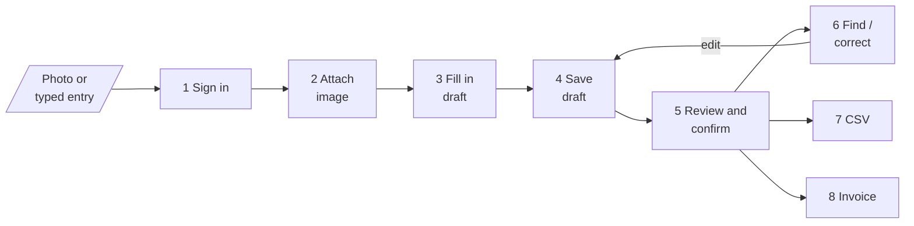
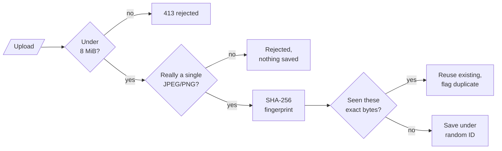
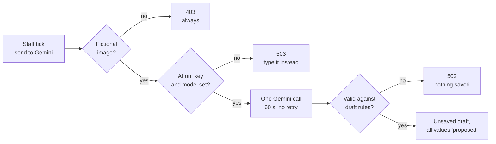
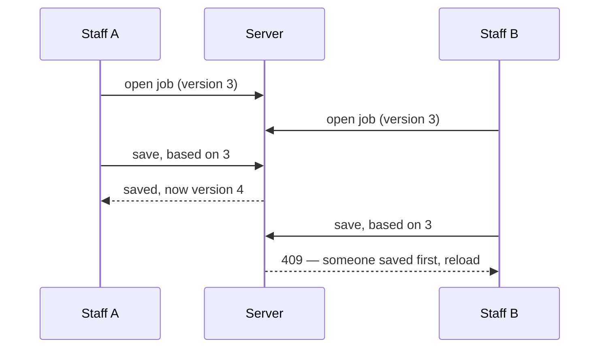
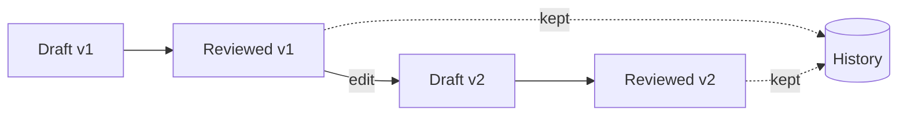
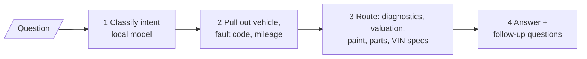
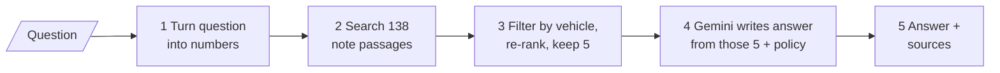

# From paper job sheet to invoice

The workshop pipeline, input to output, one step at a time

Yap Motor automotive assistant · as built, 13 October 2026 
Part 1: the paper the workshop uses today · Part 2: what the web app does with it · Part 3: the pipeline step by step 
Web app records are fictional demo data. Part 1 shows real workshop documents: keep this deck internal.

---
layout: section
---

# Part 1 — Before

What the workshop uses today: every file collected on the visit

---

# Everything collected from the workshop

17 files: paper, photos of paper and two interview transcripts. Private, not on GitHub.

| Files | What it is | Count |
|---|---|---|
| Quotation / job sheet, blank (PDF) | The form every job is written on | 1 page |
| Job sheets 1–5 (photos) | Filled in by hand | 5 photos |
| Accident report, blank (PDF) | Owner and driver particulars | 3 pages |
| Private settlement, blank (PDF) | Agreement between two drivers | 1 page |
| Warrant to act, sample (PDF) | Lets the workshop act for the owner | 1 page |
| Car, lorry, motorbike front/back (photos) | Vehicle parts reference booklet | 6 photos |
| Interview transcripts (text) | Accident paperwork; walk-ins and quotations | 2 files |

---
layout: two-cols-header
---

# The job sheet — the main document

::left::

Everything about a job goes on this one page:

- Vehicle, owner, contact, date in and date out
- Knock / spray / servicing, fuel gauge
- Up to 20 numbered lines of work, each with an amount
- A car outline to mark where the damage is
- Workshop address, phone numbers and PayNow at the bottom

It is filled in **by hand**, and it is the only record of the job.

::right::

---

# Five real job sheets

  
  
  
  
  

The sheets in use are a slightly different print run from the blank form: they have **Knock / Spray / Parts** columns, 21 lines and **Total / GST 9% / Grand total** boxes.

---
layout: two-cols-header
---

# What makes the paper hard to reuse

::left::

- Handwriting, in **English and Chinese** on the same sheet
- Shorthand such as "K/S" that only staff can explain
- Amounts **crossed out** and rewritten
- Circled numbers on the car outline that point to notes
- Totals and GST worked out by hand
- To find an old job, someone has to flip through the book

We have not been told what each shorthand means yet. The app keeps the literal writing and never guesses.

::right::

---

# Accident paperwork

  
  
  
  
  

Left to right: accident report (3 pages), private settlement form, warrant to act. These are blank forms. The web app does **not** handle them yet; only the job sheet has been built.

---

# Vehicle parts reference booklet

  
  
  
  
  
  

---
layout: section
---

# Part 2 — After

The same job sheet, in the web app

---

# Typing it in, with the paper beside it

- The photo of the sheet stays on screen (left) while staff type (right)
- Every line keeps **what was written** and **what it means**; an empty amount is never turned into zero
- Crossed-out lines are kept and marked cancelled. Nothing counts as checked until a signed-in person confirms it

---

# Finding a job again

- **Before:** flip through the job-sheet book
- **Now:** search by customer, vehicle, job number, a word in the work lines, or date
- Shows the latest checked version, warns about newer unchecked edits, and opens the original photo in one click

---

# Corrections keep their history

- **Before:** a correction is a line crossed out on the page
- **Now:** each checked version is saved for good, with who checked it and when. A correction makes a new version
- From each version: download a CSV, **print the job sheet in the paper layout** (new), or prepare an invoice

---

# New: the print-out looks like the paper

  

    
    
Paper form

  

  

    
    
Printed from the web app (fictional record)

  

The app prints the checked values **onto the workshop's own form**, so the heading, the 20 lines, the car outline and the footer are exactly where staff expect them.

---

# The invoice — on the same form

  

    
    
Today: total and GST 9% written by hand

  

  

    
    
Web app: invoice printed on the workshop form (fictional)

  

The work lines sit in the numbered rows; **Total, GST 9% and Grand total** fill the last three rows, worked out to the cent. The invoice number and date print beside the car outline. Once issued, an invoice cannot be edited.

---

# Before and after

| | Paper today | Web app |
|---|---|---|
| Record | One handwritten page | Typed record with the photo attached |
| Unclear writing | Stays unclear on the page | Marked unclear; never guessed |
| Corrections | Crossed out | New version; old versions kept |
| Finding an old job | Flip through the book | Search by customer, vehicle, job or date |
| Totals and GST | By hand | Calculated, to the cent |
| Job sheet and invoice print-out | The paper itself | Same form, filled in by the app |
| Accident forms | Paper | Not built yet |

So far tested with fictional records only. No real job sheet has been entered, and no time saving has been measured.

---
layout: section
---

# Part 3 — The pipeline

How one job sheet moves through the app, step by step

---

# What is in the project

Three parts, two running programs

| | Workshop job sheets | Automotive API | Manual assistant |
|---|---|---|---|
| Job | Paper sheet → reviewed record, CSV, invoice | Car question → answer from lookup tables | Repair question → answer from workshop notes |
| Runs on | FastAPI, port 8000 | Same program | Flask, port 8080 |
| Stores in | PostgreSQL + private files | PostgreSQL | ChromaDB |
| AI | Optional, off by default | Small local classifier | Gemini |

These slides follow the **workshop job sheet** pipeline. The other two get one slide each at the end.

---

# The whole pipeline

- **Input:** one photo of a job sheet, or values typed in directly
- **Outputs:** a reviewed record you can find again, a CSV file, an invoice with GST
- **Rule that runs through all of it:** AI may *propose*, only a person can *confirm*

---
layout: two-cols-header
---

# The input

::left::

**A photo of a paper job sheet**

- JPEG or PNG, one page
- Up to 8 MiB, 6,000 px a side, 20 megapixels

**Or no photo at all**

- Staff type the values in
- They must then say where the values came from

Each record is tagged at the start as **fictional demo** or **real company record**. That tag can never be changed later.

::right::

The fictional sheet used in the tests

---

# Step 1 — Sign in

Nothing in the workshop area is reachable until every check passes

| Check | If it fails |
|---|---|
| Workshop feature is switched on | 404 — looks like it does not exist |
| Account, password hash and site address are configured | 503 — refuses to start half-configured |
| Username and password are correct | 401 — browser asks again |
| Request comes from the workshop page itself | 403 — other websites are blocked |

- One configured account; password stored as a salted scrypt hash, never as text
- Runs **before** any upload is read, so an anonymous visitor cannot send files
- Every page and download is marked "do not cache"

---

# Step 2 — Attach the image

`POST /api/v1/workshop/documents`

- The original bytes are kept untouched; zoom and rotate only change the view
- The uploaded filename is never used as a file path
- Files sit in a private folder outside the public web folder

---
layout: two-cols-header
---

# Step 3 — Fill in the draft

::left::

The photo stays on screen beside the form.

Every value is kept twice: **literal** (exactly what is written) and **clarified** (what it means).

Every value carries a state:

- `missing` — not on the sheet
- `unclear` — cannot be read for sure
- `proposed` — filled in, not yet checked
- `confirmed` — a person checked it

Empty means unknown. It never means zero.

::right::

  

---

# Step 3b — Optional: let AI propose the draft

`POST /api/v1/workshop/documents/{id}/extract`

- The AI is told to copy what is written, leave doubt empty, and never add totals, tax or currency
- It cannot choose the record stage, read the damage diagram, or mark anything confirmed
- Real company records are blocked in code until the company agrees to the processing

---

# Step 4 — Save the draft

`POST /jobs` to create · `PATCH /jobs/{id}` to save again

- The whole draft is stored as one JSON document
- Every save raises the **version number** by one
- A save must say which version it started from, so two people cannot overwrite each other

---

# Step 5 — Review and confirm

`POST /jobs/{id}/confirm`

Before a draft can become a reviewed record:

- A stage is chosen — **quote**, **approved scope** or **completed work**
- There is a job reference
- At least one item has a confirmed description
- No value is still `proposed` or `unclear`
- There is a source image, or a written note of where the values came from
- The image on disk still matches its fingerprint
- The reviewer ticks "I checked these values against the source"

Then the server writes **one snapshot that can never be edited or deleted** — the database itself refuses. It records the signed-in account and the server's time, not what the browser claims.

Confirming a quote leaves it a quote. Review and stage are separate ideas.

---

# Step 6 — Find it again, correct it

`GET /jobs` · `GET /jobs/{id}/revisions`

**Find**

- Search by keyword, customer, vehicle, reference, stage or review date
- Returns the **latest reviewed** version of each job
- Jobs that are only drafts do not appear
- Two jobs with the same customer name are never merged

**Correct**

- Editing a reviewed record starts a new draft version
- Edited values drop back to `proposed`
- It must be reviewed again
- Every earlier snapshot stays readable, with who reviewed it and when

---

# Step 7 — Download the CSV

`POST /revisions/{id}/exports` then `GET /exports/{id}/download`

- Built from a **reviewed snapshot**, never from a draft
- 32 columns, one row per line item, opens in Excel (UTF-8 with BOM)
- Generated once, stored with a fingerprint; downloading again gives the same bytes
- Cells starting with `=`, `+`, `-` or `@` are escaped so a spreadsheet cannot run them as formulas

| output_kind | revision | record_stage | job_reference | description | amount | currency |
|---|---|---|---|---|---|---|
| DEMO_ONLY | 2 | quote | DEMO-JOB-001 | Example filter replacement | 25.10 | SGD |

The column layout is a demo. It is not matched to any accounting software.

---

# Step 8 — Issue the invoice

`POST /revisions/{id}/invoice-preview` then `POST /revisions/{id}/invoice`

**Allowed only when**

- Stage is **completed work**, in SGD
- Every item has a confirmed price
- The revision is the latest saved version
- The job has no invoice yet
- Invoice date is today (Singapore)

**GST 9%, worked out once on the subtotal**

| | GST-inclusive |
|---|---|
| Line total | 109.00 |
| Net | 100.00 |
| GST 9% | 9.00 |
| **Payable** | **109.00** |

- Stored as finished HTML with a fingerprint; print or save as PDF from the browser
- One invoice per job. It cannot be replaced or edited
- Fictional records get `DEMO-INV-…` numbers. Real invoices are off until the supplier details are set

---

# Where each step lands

| Step | Written to | Can it change later? |
|---|---|---|
| 2 Attach | `workshop_documents` + private file | No — bytes are fingerprinted |
| 4 Save | `workshop_jobs` | Yes — this is the working draft |
| 5 Confirm | `workshop_job_revisions` | **No — locked** |
| 7 CSV | `workshop_exports` + private file | No — same bytes every download |
| 8 Invoice | `workshop_invoices` | **No — locked** |

- Five PostgreSQL tables plus one private folder
- "Locked" tables have a database trigger that rejects any change or delete
- Backup and restore of database + files has been rehearsed in a test

---

# The other two pipelines

**Automotive API** — typed question in, structured answer out

**Manual assistant** — question in, written answer with sources out

Neither one reads or writes workshop job records.

---

# What is checked, what is not

**Checked**

- 326 automated tests pass
- 18 of them run the workshop against real PostgreSQL
- Full flow clicked through in Chrome
- One live Gemini run on the printed fictional sheet
- Backup and restore rehearsed

**Not yet**

- No real company record has gone through
- Handwriting accuracy is unmeasured
- Shorthand and diagram meanings need the workshop to explain them
- Permission to send real sheets to an AI provider
- Supplier name, address and GST number for real invoices

Full detail: SYSTEM_DESIGN.md and car mechanic assistant/WORKSHOP_MASTER_PLAN.md

